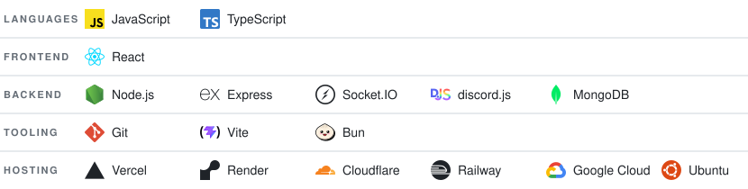

17 y/o developer from Türkiye. I build full-stack web apps and desktop tools, and I like shipping things people can actually install and use.

## Tech Stack

<picture>
  <source media="(prefers-color-scheme: dark)" srcset="assets/stack-v2-dark.svg">
  
</picture>

## Projects

### [FICSIT Planner](https://github.com/Albis0/ficsit_planner) — Satisfactory factory & power planner

Tell it what you want per minute and it plans the whole factory: recipes, machine counts, clock speeds, belts and pipes.

- LP solver (HiGHS in WebAssembly, in a Web Worker) so the page never freezes
- Power planner, codex, resource map and transport calculator
- Installable PWA, works offline

**Stack:** React • TypeScript • Vite • HiGHS • Zustand • Cloudflare Pages + D1
**Live:** [ficsitplanner.app](https://ficsitplanner.app)

---

### [yt2mp](https://github.com/Albis0/yt2mp) — Ad-free YouTube → MP3/MP4 downloader

A desktop app that runs on your own machine: no shared server, no upload limits, no ads.

- Videos, playlists or AI search, with pause and resume
- Built-in converter for 34 formats
- Windows installer and Linux AppImage

**Stack:** Tauri • React • TypeScript • yt-dlp • ffmpeg
**Download:** [Latest release](https://github.com/Albis0/yt2mp/releases/latest)

---

### [Glimpse](https://github.com/Albis0/Glimpse) — Multi-API image search

Search Unsplash, Pexels and Pixabay from one place.

- Accounts, favorites and quality selection up to 4K
- Infinite scroll with a masonry grid

**Stack:** React • Node.js • Express • MongoDB • JWT • Cloudinary
**Live:** [glimpse-dun-seven.vercel.app](https://glimpse-dun-seven.vercel.app)

---

### [Vavis](https://github.com/Albis0/Vavis) — Windows-native AI assistant

A personal AI assistant for Windows in a single `.exe`, no install.

- 14 model providers with fallbacks, plus local models
- Voice, local memory and 73 tools that control apps by name
- Automations, Telegram control and approval prompts for risky actions

**Stack:** Rust • Tauri • React • TypeScript • Vite
**Download:** [Latest release](https://github.com/Albis0/Vavis/releases/latest)

## Activity

<picture>
  <source media="(prefers-color-scheme: dark)" srcset="assets/activity-dark.svg">
  
</picture>

## Get In Touch

