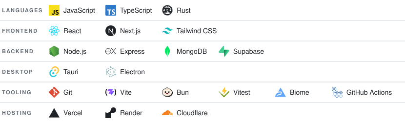

17 y/o developer from Türkiye. I build full-stack web apps and desktop tools, and I like shipping things people can actually install and use.

## Tech Stack

<picture>
  <source media="(prefers-color-scheme: dark)" srcset="assets/stack-dark.svg">
  
</picture>

## Projects

### [FICSIT Planner](https://github.com/Albis0/ficsit_planner) — Satisfactory factory & power planner

Enter what you want per minute and it plans the whole factory: picks the recipes, counts the machines, sets their clock speeds and draws it all with belts and pipes.

- An LP solver (HiGHS compiled to WebAssembly, in a Web Worker) does the maths, so the page never freezes
- Power planner for generators, fuel chains, augmenters and backup storage, sized to the factories it feeds
- Codex of parts, buildings, milestones, research and alternate recipes, plus a world map with every resource node
- Transport calculator for belts, trains, trucks and drones; share links; settings for layout, colours and game multipliers
- Game data extracted straight from the game files
- Installs as an app and works offline, on desktop and phone

**Stack:** React • TypeScript • Vite • HiGHS • React Flow • Zustand • Leaflet • PWA • Bun • Cloudflare Pages + D1
**Live:** [ficsitplanner.app](https://ficsitplanner.app)

---

### [yt2mp](https://github.com/Albis0/yt2mp) — Ad-free YouTube → MP3/MP4 downloader and converter

The actual work runs as a desktop app on your own machine: no shared server, no upload limits, no ads.

- Paste a link (video or playlist) or use **AI search** to describe what you want
- Pause, resume or stop downloads mid-transfer
- Built-in converter: turns videos, songs and pictures into 34 formats, with a queue and graphics-card encoding when available
- Built-in browser with a Download button
- Updates itself; Windows installer and Linux AppImage

**Stack:** Tauri • React • TypeScript • yt-dlp • ffmpeg • Next.js (landing page)
**Download:** [Latest release](https://github.com/Albis0/yt2mp/releases/latest)

---

### [Glimpse](https://github.com/Albis0/Glimpse) — Multi-API image search

Search photos across Unsplash, Pexels and Pixabay from a single interface.

- Accounts with profile pictures and password reset by email
- Favorites
- Image preview with download, and quality selection from thumbnail to 4K
- Infinite scroll, masonry grid and a responsive mobile layout

**Stack:** React • Node.js • Express • MongoDB • JWT • Axios • Cloudinary • Resend
**Live:** [glimpse-dun-seven.vercel.app](https://glimpse-dun-seven.vercel.app)

---

### [Vavis](https://github.com/Albis0/Vavis) — Windows-native AI assistant

A personal AI assistant for Windows in a single `.exe`, no install. Rewritten from scratch (formerly AEGIS) with a Rust backend and a Tauri window.

- **Any model:** 14 providers, including Claude Code, Gemini, Groq, Cerebras, OpenRouter, Mistral, NVIDIA, GitHub Models and local models (Ollama / LM Studio), with fallbacks when a quota runs out
- **Voice:** on-device wake word and live conversation (Gemini Live)
- **Memory:** local semantic memory that learns about you
- **Computer control:** 73 tools that reach buttons and fields in any window by name (UI Automation) and control files, apps, media, Spotify, Steam, Obsidian and MCP servers
- **Automations:** fire on time, battery, CPU or events like a new download
- **Code mode, Telegram control and Council:** edit and test a project, use it from your phone, or ask several models the same question side by side
- **Safety:** destructive actions ask for approval, prompt injection from pages and files is guarded against, and API keys are encrypted with Windows DPAPI

**Stack:** Rust • Tauri • React • TypeScript • Vite
**Download:** [Latest release](https://github.com/Albis0/Vavis/releases/latest)

## Activity

<picture>
  <source media="(prefers-color-scheme: dark)" srcset="assets/activity-dark.svg">
  
</picture>

## Get In Touch

